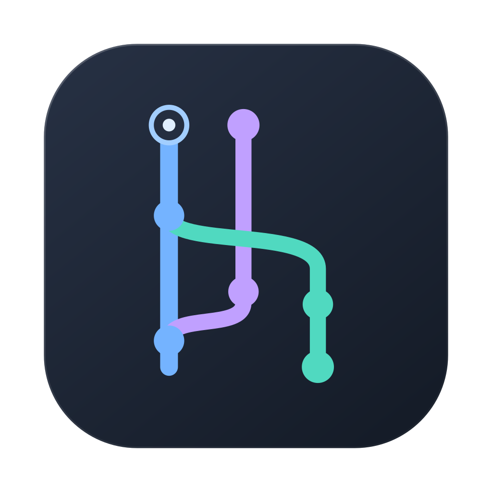
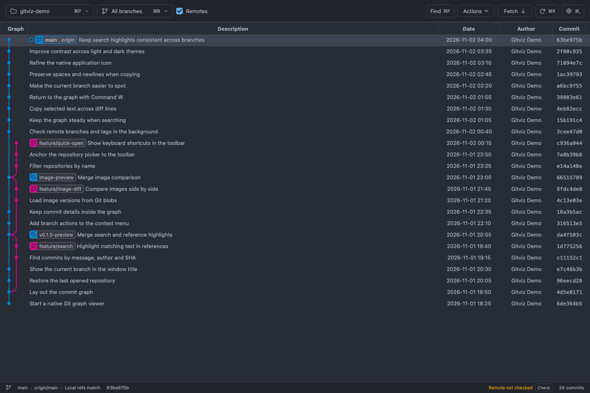

<p align="center"></p>

# Gitviz — Native Git Graph Viewer for macOS

A standalone macOS Git client for exploring commit history, branches and tags. Inspect a commit inside the graph, open a full-size code or image diff, and move between repositories without leaving your desktop.

**[Website](https://senwong.github.io/gitviz-mygo/)** · **[Download for macOS](https://github.com/senwong/gitviz-mygo/releases/latest/download/Gitviz-macOS-universal.zip)** · **[Installation guide](https://senwong.github.io/gitviz-mygo/install/)** · **[中文说明](README.zh-CN.md)**



*Real application rendering with a synthetic demo repository. No private repository data is shown.*

## Why Gitviz?

- **See the history.** Follow colored branch lanes, merge connections, local and remote branches, and tags.
- **Stay in context.** Expand commit details and changed files inside the graph; open a file for a larger diff and return with ⌘W.
- **Read the changes.** Search code diffs, select and copy across lines, or compare image versions side by side.
- **Move between projects.** Search repositories by name and open VS Code `.code-workspace` files.
- **Know what is local.** Inspect the current branch's ahead/behind counts and check remote branch and tag updates. Optional automatic Fetch refreshes refs when switching repositories; it does not pull or merge into your local branch.
- **Make it comfortable.** Choose from light and dark themes, use visible keyboard shortcuts, and restore your last repository on launch.

Gitviz runs as its own desktop application. It is inspired by the workflow of VS Code Git Graph, but is a separate project with its own implementation. The Go implementation in this repository uses [MyGo](https://github.com/egoist/mygo); the [Rust implementation](https://github.com/senwong/gitviz) is maintained separately.

## Download and install

Download the latest **[Gitviz for macOS](https://github.com/senwong/gitviz-mygo/releases/latest/download/Gitviz-macOS-universal.zip)**, unzip it, and drag `gitviz.app` to Applications.

- macOS 13 or later; a universal application for **Apple Silicon and Intel**.
- Git must be available on your system. If you do not have it, install Apple's Command Line Tools with `xcode-select --install`.
- The current release is **ad-hoc signed and not notarized by Apple**. macOS may require you to allow it in **System Settings → Privacy & Security → Open Anyway** after the first launch attempt. See the [installation guide](https://senwong.github.io/gitviz-mygo/install/) for the complete steps.
- Verify your download against the `SHA256SUMS.txt` attached to the same release.

## Build from source

Requirements: macOS, Git and Go 1.27.3 or later. MyGo is pinned in `go.mod`.

```sh
git clone https://github.com/senwong/gitviz-mygo.git
cd gitviz-mygo
./script/build
./build/gitviz-mygo /path/to/repository
# Or open a VS Code workspace:
./build/gitviz-mygo /path/to/project.code-workspace
```

Without a path, Gitviz restores the previous workspace and repository. Settings live in `~/.config/gitviz-mygo/`.

```sh
./script/verify   # Formatting, go vet, race tests, then build
./script/package  # Locally signed app for the current architecture
./script/release  # Universal macOS app ZIP and SHA-256 checksum
```

The race test suite includes native rendering and temporary Git repositories; runtime varies by machine. Some full theme and real-workspace screenshot checks are opt-in.

## Keyboard shortcuts

| Shortcut | Action |
| --- | --- |
| ⌘P | Choose a repository |
| ⌘⇧P | Open the command palette |
| ⌘B | Choose a branch filter |
| ⌘F | Find in the graph or current text diff |
| ⌘G / ⌘⇧G | Next / previous match |
| ⌘R | Refresh the graph |
| ⌘, | Open settings |
| ⌘W | Return from a diff to the graph; otherwise close the window |
| ⌘Q | Quit |

## FAQ

**Is Gitviz a VS Code extension?** No. It is a standalone native desktop application.

**Does switching repositories pull code?** No. Automatic Fetch, when enabled, updates remote refs and tags. Pull and merge are separate actions.

**Can it display binary image changes?** Yes. Supported raster images can be previewed from the selected Git revisions, with before/after views and a text-diff fallback.

**Does it support Windows or Linux?** The downloadable release is currently for macOS. Other platforms are not distributed or verified by this project.

**Does it replace Git?** No. Gitviz uses your installed Git executable and existing Git authentication.

## Project links

- [Features](https://senwong.github.io/gitviz-mygo/features/)
- [Gitviz and VS Code Git Graph](https://senwong.github.io/gitviz-mygo/comparison/)
- [Releases](https://github.com/senwong/gitviz-mygo/releases)
- [Report an issue](https://github.com/senwong/gitviz-mygo/issues)

The static website lives in `docs/`; run `python3 script/build-site.py` to regenerate its HTML.

To regenerate app icons, run `./script/icon` with `rsvg-convert` and macOS `iconutil` installed. To reproduce the public demo screenshots, run `python3 script/capture-product-screenshots.py`; it uses a temporary repository and does not read your personal repositories or preferences.
